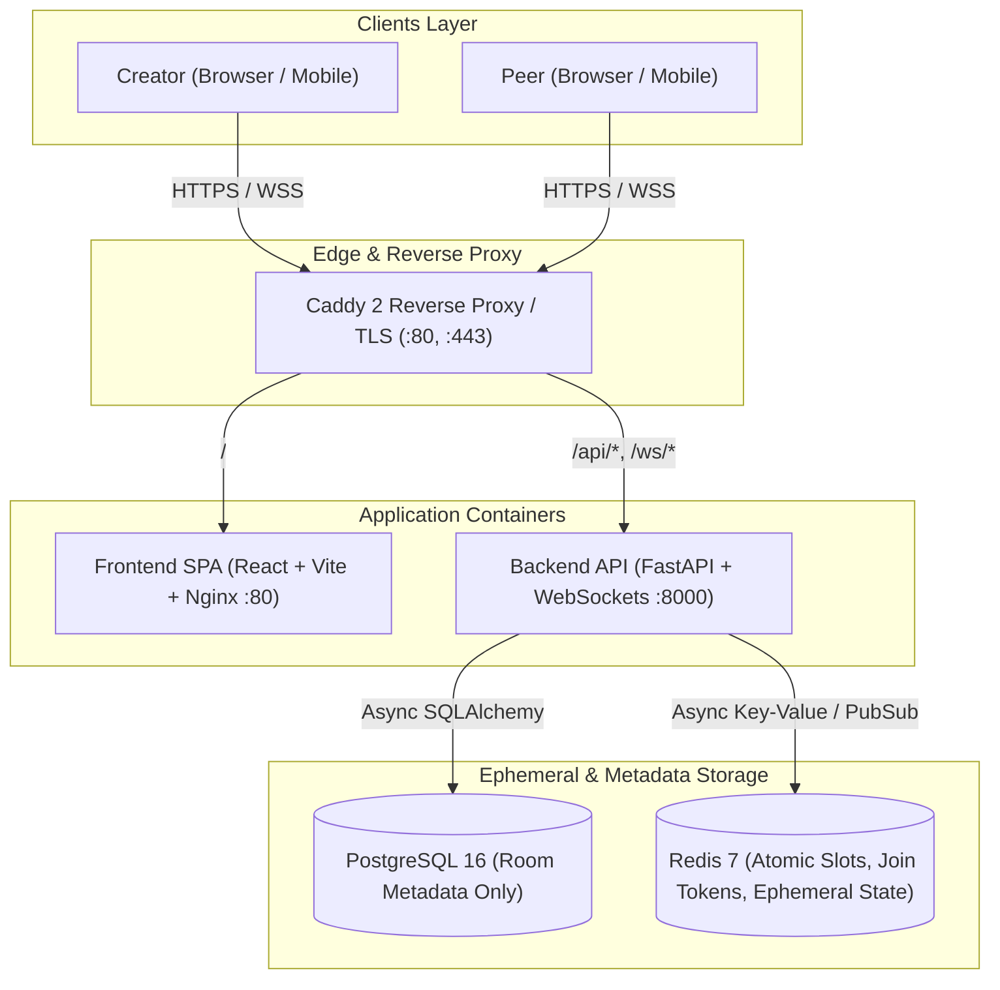
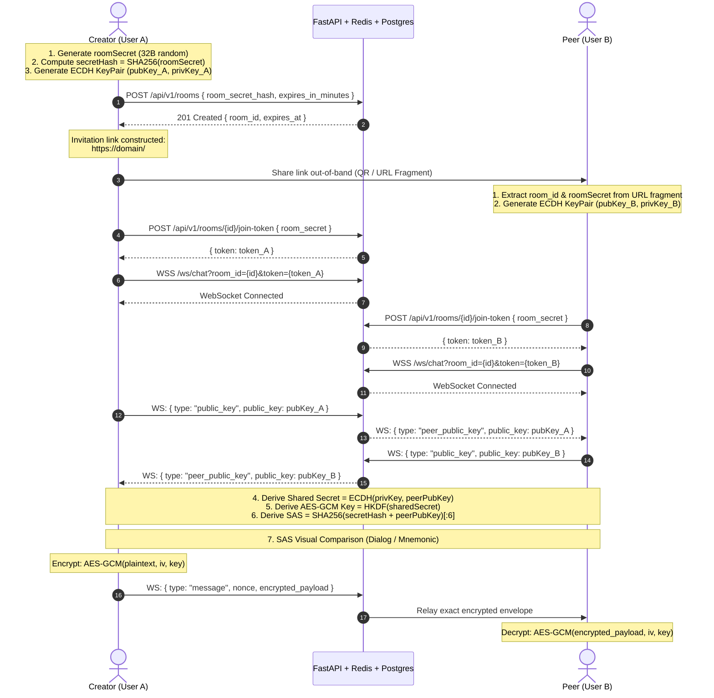
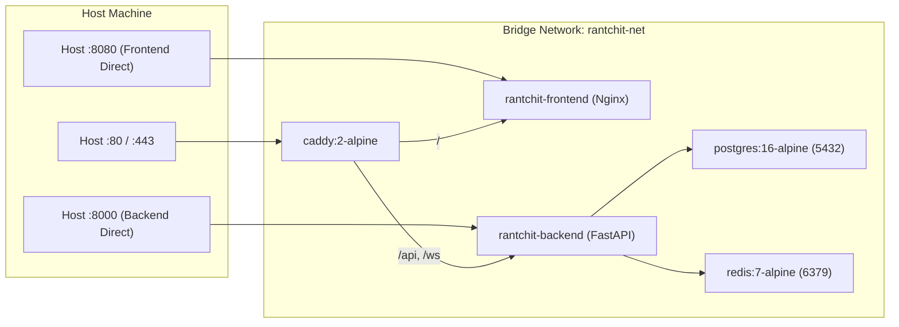

# Rantchit — Repository & Architecture Guide (`GEMINI.md`)

> **Rantchit** (*Chat with Randomness at Once*) is a privacy-first, zero-knowledge, ephemeral 1-on-1 end-to-end encrypted (E2EE) conversation platform. 
> Designed with standard cryptographic primitives (Web Crypto API: ECDH / X25519, HKDF-SHA256, AES-256-GCM), server-side zero plaintext persistence, atomic participant limits (strictly 2 users per room), and one-click room destruction.

---

## 1. System Architecture & "Graphify" Repository Visualizations

### 1.1 High-Level Component Graph



### 1.2 End-to-End Encryption (E2EE) Handshake & Relay Flow



### 1.3 Docker Container & Network Topology



---

## 2. Monorepo Structure Map

```
D:\RHS_Work\Rantchit\
├── .env                              # Environment configuration for local & docker runs
├── .env.example                      # Template environment variables
├── docker-compose.yaml               # Orchestrates Postgres, Redis, Backend, Frontend, Caddy
├── GEMINI.md                         # This architecture and engineering manual
├── CLAUDE.md                         # Compact agent & developer commands
├── README.md                         # High-level repo summary
├── README-Ideate.md                  # Comprehensive architectural blueprint and threat model
│
├── infra/
│   ├── caddy/
│   │   └── Caddyfile                 # Caddy reverse proxy rules (/ -> frontend, /api,/ws -> backend)
│   ├── postgres/
│   │   └── init.sql                  # Initial database seed script (if needed)
│   └── k8s/                          # Kubernetes deployment manifests
│
├── src/
│   ├── backend/                      # FastAPI Python Application
│   │   ├── Dockerfile                # Multi-stage optimized Python 3.11 container
│   │   ├── requirements.txt          # Python dependencies (FastAPI, SQLAlchemy, asyncpg, redis, etc.)
│   │   ├── alembic/                  # Database migrations
│   │   │   ├── env.py
│   │   │   └── versions/
│   │   ├── tests/                    # Pytest test suite
│   │   └── app/
│   │       ├── main.py               # Application entry point, lifespan, CORS, route inclusion
│   │       ├── config.py             # Pydantic Settings loaded from .env
│   │       ├── database.py           # Async SQLAlchemy engine & sessionmaker
│   │       ├── models.py             # Room database model
│   │       ├── schemas.py            # Pydantic schemas (RoomCreate, JoinToken, etc.)
│   │       ├── security.py           # SHA-256 room secret hashing, HMAC IP hashing, token gen
│   │       ├── redis_client.py       # Async Redis connection pool
│   │       ├── websocket_manager.py  # WebSocket connection tracking & broadcasting
│   │       ├── endpoints/
│   │       │   ├── rooms.py          # REST endpoints (/api/v1/rooms)
│   │       │   ├── ws.py             # WebSocket endpoint (/ws/chat)
│   │       │   └── health.py         # System health & liveness (/health, /api/v1/health)
│   │       └── utils/
│   │           ├── logging.py        # Structured JSON logging
│   │           ├── rate_limit.py     # Redis token bucket rate limiting
│   │           └── validation.py     # Input payload validation
│   │
│   └── frontend/                     # React 18 + TypeScript + Vite + TailwindCSS SPA
│       ├── Dockerfile                # Multi-stage build (Node 20 -> Nginx Alpine)
│       ├── nginx.conf                # Nginx SPA fallback routing and security headers
│       ├── package.json              # React, React Router, TailwindCSS, Vite
│       ├── vite.config.ts            # Vite config with /api and /ws proxies
│       ├── tailwind.config.js        # Custom Tailwind styling & animations
│       ├── index.html                # Entry HTML with Inter fonts & meta tags
│       └── src/
│           ├── main.tsx              # Root render with BrowserRouter
│           ├── App.tsx               # Route definitions (/, /room/:roomId, /error)
│           ├── index.css             # Tailwind utilities, glowing effects, glassmorphism
│           ├── lib/
│           │   ├── crypto.ts         # Web Crypto API wrapper (ECDH, HKDF, AES-GCM)
│           │   ├── api.ts            # REST API client for rooms & join tokens
│           │   ├── websocket.ts      # WebSocket wrapper with reconnect & ping
│           │   ├── sas.ts            # Short Authentication String generator
│           │   ├── constants.ts      # App constants & limits
│           │   └── types.ts          # TypeScript interfaces
│           ├── hooks/
│           │   ├── useCrypto.ts      # Keypair generation and encryption state hook
│           │   ├── useRoom.ts        # Room join/creation and lifecycle hook
│           │   ├── useWebSocket.ts   # WebSocket connection and message dispatch hook
│           │   └── useCountdown.ts   # Room remaining TTL countdown hook
│           ├── components/
│           │   ├── RoomHeader.tsx    # Header with status badge, timer, and destroy button
│           │   ├── ChatMessage.tsx   # Message bubble with sender and E2EE verification
│           │   ├── ChatInput.tsx     # Message input box with shortcuts and character counter
│           │   ├── VerificationModal.tsx # SAS code & emoji verification dialog
│           │   ├── InviteModal.tsx   # Shareable link modal with QR code and 1-click copy
│           │   ├── ConnectionStatus.tsx  # Cryptographic handshake progress indicator
│           │   └── AccessibleModal.tsx   # Accessible dialog modal wrapper
│           └── pages/
│               ├── HomeScreen.tsx    # Landing page, alias generator, room creator
│               ├── RoomScreen.tsx    # Live encrypted chat interface
│               └── ErrorScreen.tsx   # Room expired / full / error fallback screen
```

---

## 3. Cryptographic Specification

| Primitive | Standard / Algorithm | Parameters / Curve | Usage |
|:---|:---|:---|:---|
| **Room Secret** | Cryptographically Secure RNG | 32 random bytes (256-bit), Base64URL | Generated in URL fragment `#<secret>`; never sent in raw form to server during creation |
| **Room Secret Hash**| SHA-256 | Hex string (64 characters) | Sent to `POST /api/v1/rooms` to identify room authorization |
| **Key Agreement** | ECDH | Curve P-256 (`prime256v1`) / X25519 | Ephemeral client keypair generated per session |
| **Key Derivation** | HKDF | SHA-256, info=`"rantchit-session-key"`, salt=`""` | Derives 256-bit AES-GCM key from ECDH shared bits |
| **Message Encryption**| AES-GCM | 256-bit key, 12-byte unique random IV/nonce per message | Encrypts plaintext message payload |
| **SAS Verification**| SHA-256 Digest | First 6 Hex chars + 4-emoji fingerprint | User-verifiable Short Authentication String to prevent MITM |
| **IP Hashing** | HMAC-SHA256 | Keyed with backend `SECRET_KEY` | Privacy-preserving rate-limit bucket identifier |

---

## 4. Redis Key Structure & TTL Rules

| Key Pattern | Redis Type | Description | Expiration / TTL |
|:---|:---|:---|:---|
| `room:{room_id}:slots` | String (Integer) | Atomic participant counter (`INCR`, max 2) | Equal to room lifetime (e.g. 60m) |
| `room:{room_id}:token:{token}` | String | One-time WebSocket join token validator | 120 seconds |
| `room:{room_id}:peer_pubkey` | String | Public key of first participant | Equal to room lifetime |
| `room:{room_id}:creator_pubkey` | String | Public key of room creator | Equal to room lifetime |
| `ratelimit:ip:{ip_hash}:create` | String (Integer) | Rate limit counter for room creations | 3600 seconds (1 hour) |
| `ratelimit:ip:{ip_hash}:messages` | String (Integer) | Rate limit counter for WebSocket messages | 60 seconds (1 minute) |

---

## 5. Development & Docker Commands

### 5.1 Docker Compose (Recommended)
```bash
# Start all services with automated build
docker compose up -d --build

# View container logs
docker compose logs -f backend frontend

# Check running status
docker compose ps

# Stop stack and remove volumes
docker compose down -v
```

### 5.2 Local Development Setup

#### Backend:
```bash
cd src/backend
python -m venv venv
source venv/bin/activate # or venv\Scripts\activate on Windows
pip install -r requirements.txt
uvicorn app.main:app --host 0.0.0.0 --port 8000 --reload
```

#### Frontend:
```bash
cd src/frontend
npm install
npm run dev
# Accessible at http://localhost:5173
```
